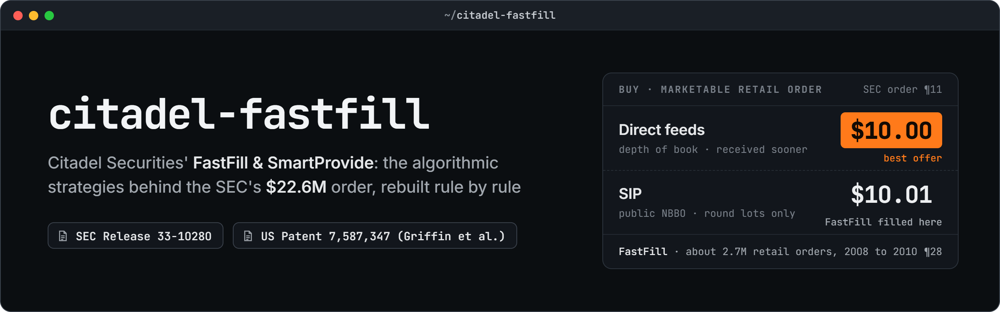
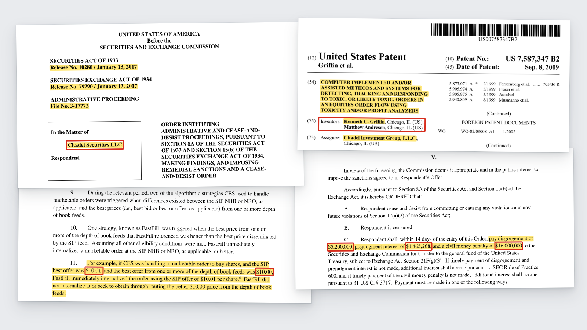
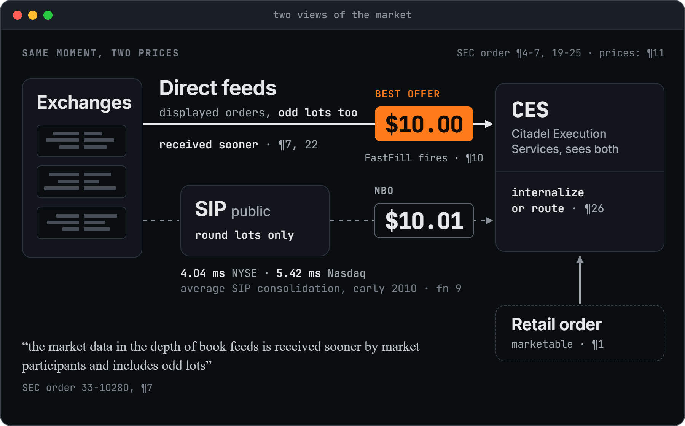
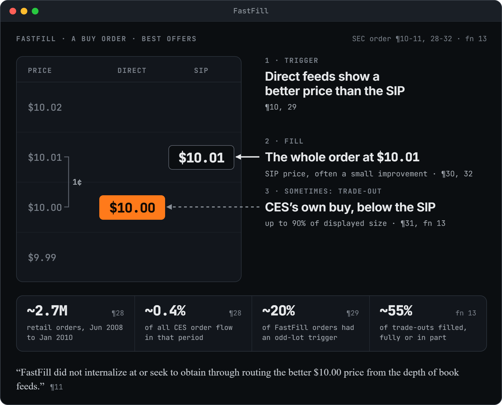
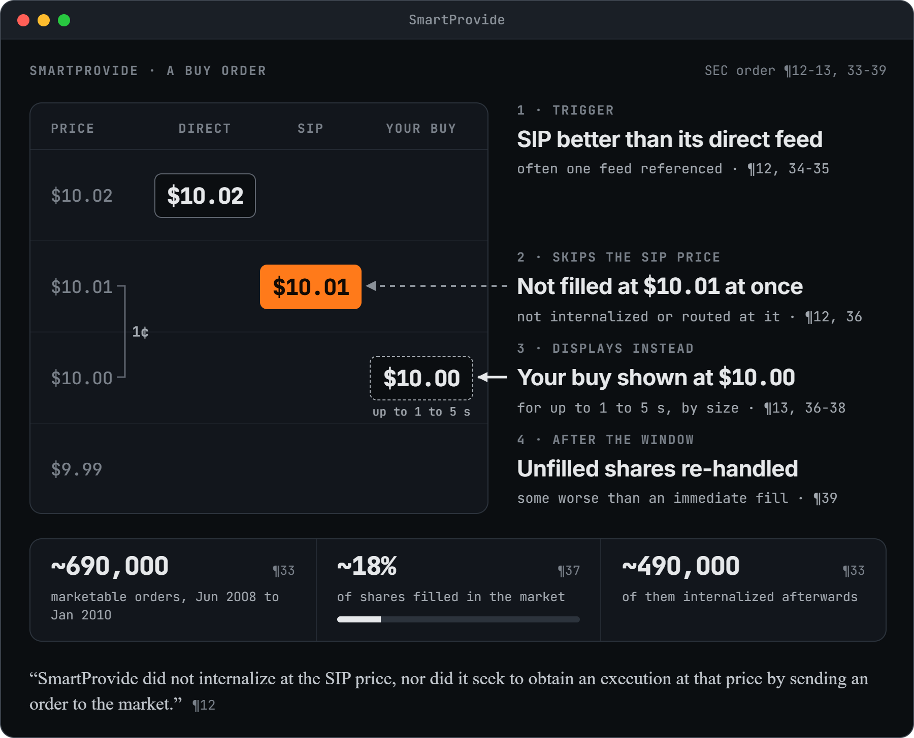
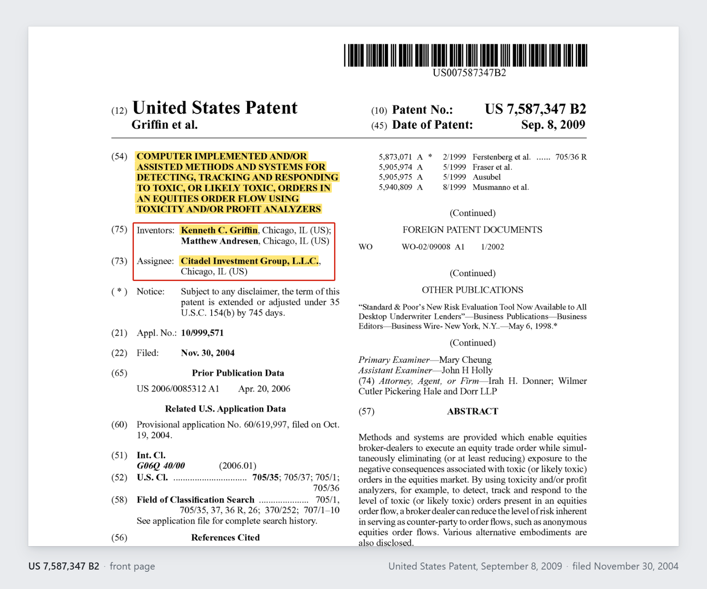
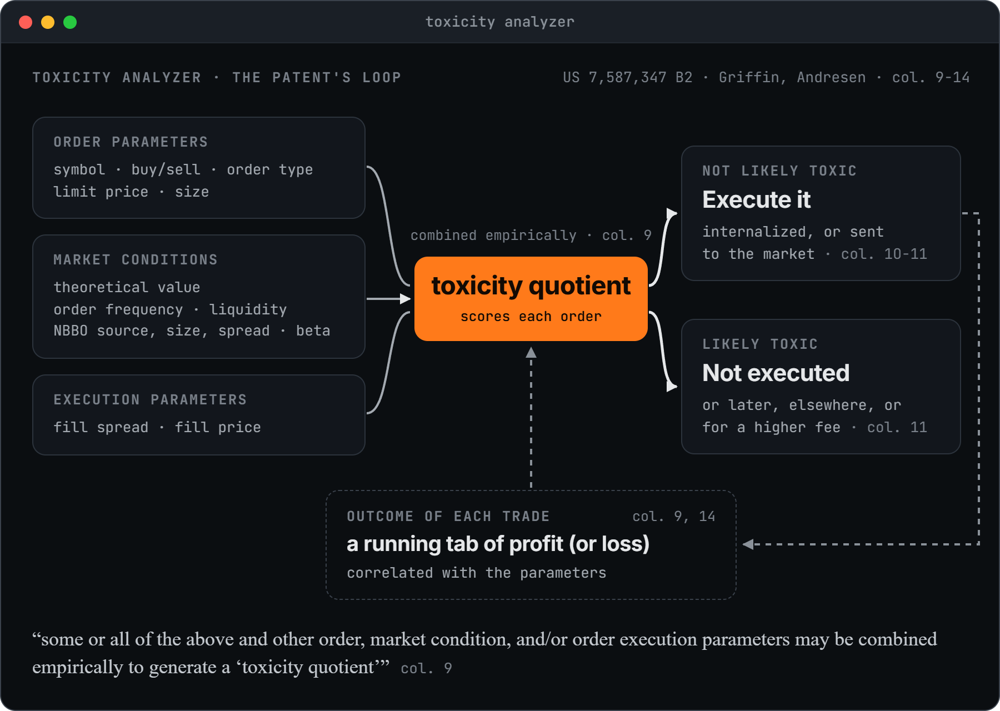

<p align="center"></p>

<p align="center">
  <a href="https://www.sec.gov/litigation/admin/2017/33-10280.pdf"></a>
  <a href="https://patents.google.com/patent/US7587347B2/en"></a>
  
  
  
  
</p>

# citadel-fastfill

**FastFill and SmartProvide, the two algorithmic strategies the SEC described in its $22.6M order against Citadel Securities, rebuilt rule by rule from the SEC's own text. Every rule in the code points to the SEC paragraph or patent passage it comes from, and every assumption of ours is marked OURS. Runs on live order books from Coinbase, Kraken, Bitstamp and Gemini, and ships ready for Claude Code.**

> "Internalizers can't suggest they are doing one thing yet do another when it comes to pricing trades."
> Stephanie Avakian, Acting Director of the SEC's Division of Enforcement, January 13, 2017

<p align="center"></p>
<p align="center"><sub>SEC order 33-10280, pages 1, 4 and 11; top right: patent US 7,587,347, a separate document that the order never mentions.</sub></p>

## What the SEC found

On January 13, 2017 the SEC settled with Citadel Securities LLC ([Release No. 33-10280](https://www.sec.gov/litigation/admin/2017/33-10280.pdf), Administrative Proceeding File No. 3-17772). Citadel Execution Services (CES), the Citadel Securities business unit that handles orders from retail broker-dealers and other sources by internalizing or routing them (paras 3, 17), used "algorithmic strategies" to handle marketable orders (paras 8-9). From late 2007 to January 2010 two of them worked like this:

- **FastFill** executed about **2.7 million retail orders** from June 2008 to January 2010 (para 28). When one or more of the depth-of-book feeds it referenced showed a better price than the consolidated public quote (the SIP), it immediately internalized the order at the SIP price or better, if its other eligibility conditions were met: a buy at the SIP offer of **$10.01** while the direct feeds showed **$10.00** (paras 10-11, 29-30).
- **SmartProvide** handled about **690,000 marketable orders** (para 33). When the SIP showed a better price than at least one depth-of-book feed it referenced, it did not fill at the SIP price; it displayed a non-marketable order in the market instead, for **up to one to five seconds** depending on the order's size (paras 12-13, 36-38). About **18%** of those shares were filled in the market, likely at a better price (para 37); about 490,000 orders were internalized afterwards, some at a worse price (paras 33, 39).

The two handled about 2.6% of the retail orders in CES's algorithmic engine and 0.6% of its overall order flow (para 18). At the time of the order (January 2017), CES's orders accounted on average for about 35% of the average daily volume of retail equity shares traded in the US (para 17). Citadel Securities was ordered to pay **$5,200,000** disgorgement, **$1,465,268** prejudgment interest and a **$16,000,000** civil penalty, **$22,665,268** in total, and was censured (Section V). It neither admitted nor denied the findings. CES had already discontinued both algorithms (para 3).

## How it works

<p align="center"></p>

**Two views of the same market.** Each exchange's depth-of-book feed shows every displayed order, odd lots included, and reaches a fast reader first. The SIP consolidates only round lots and arrives later; its consolidation alone averaged 4.04 ms (NYSE) and 5.42 ms (Nasdaq) in early 2010 (fn 9). Whoever reads both can see the price move before the public quote does (paras 19-25).

<p align="center"></p>

**FastFill.** Trigger: one or more depth-of-book feeds show a better price than the SIP (para 29); about 20% of FastFill internalizations were triggered by an odd lot. Action: fill the entire remaining order at the SIP price, often with a small price improvement that "often was not sufficient to equal the price difference that had triggered the strategy" (paras 30, 32). In a narrow set of circumstances (no principal interest, or a position limit) FastFill still internalized the order and at the same moment sent its own order to take the better price for itself, a "trade out attempt", allowed only if that order was no greater than 90% of the size at the better depth-of-book price; those filled in full or in part about 55% of the time (para 31, fn 13).

<p align="center"></p>

**SmartProvide.** Trigger: the SIP shows a better price than at least one depth-of-book feed it referenced, often just one feed (paras 34-35). Action: display a non-marketable order below the SIP offer (or above the SIP bid) for up to one to five seconds depending on size, or until CES chose a new strategy (paras 36-38), then re-evaluate what is left: display it under another strategy, route it to take liquidity, or internalize it (para 39).

## The toxicity analyzer from Citadel Investment Group's patent (filed 2004, granted 2009; our choice for the principal-interest step)

The SEC order does not say how CES decided whether it had a "principal interest" in an order (para 26). For that step we use the toxicity analyzer of Citadel Investment Group's patent [US 7,587,347 B2](https://patents.google.com/patent/US7587347B2/en) (filed November 30, 2004; granted September 8, 2009; inventors Kenneth C. Griffin and Matthew Andresen), titled "Computer implemented and/or assisted methods and systems for detecting, tracking and responding to toxic, or likely toxic, orders in an equities order flow using toxicity and/or profit analyzers". Neither document links the two; the link is ours, and it is marked OURS everywhere in the code.

<p align="center"></p>
<p align="center"></p>

`citadel/toxicity.py` follows the patent's own steps on public data: record the order, market-condition and execution parameters of every fill, keep a running profit tab from the spread at the fill (col. 14), combine the parameters empirically into a toxicity quotient, and respond. Every step cites its column and line.

## Run it

```bash
git clone https://github.com/Carm1ne6/citadel-fastfill && cd citadel-fastfill
pip install -e .

citadel-fastfill live                                  # every FastFill / SmartProvide on BTC/USD as it happens (after a 60 s warm-up)
citadel-fastfill record --minutes 20 --out data/run1   # save 20 minutes of order books from 4 exchanges
citadel-fastfill replay --data data/run1               # replay them and print the report next to the SEC's numbers
```

No API keys. Only public market data is read; no order is ever sent, and the only messages sent to an exchange are subscriptions to its public market-data channels. `python live.py`, `python record.py` and `python run.py --data data/run1` work too.

**Configure everything in one file.** Copy `fastfill.example.toml` to `fastfill.toml` and pass `--config fastfill.toml`. Every parameter is listed with its default, its meaning and its source: the SEC paragraph, the patent column, or OURS.

## Use it with Claude Code

The repo is set up for AI agents out of the box:

- **`CLAUDE.md` / `AGENTS.md`** tell any coding agent what the repo is, how to run it and the rules for changing it (every rule cites its paragraph, nothing is presented as Citadel's code, our assumptions are marked OURS, tests must pass).
- **A Claude Code skill** in `.claude/skills/citadel-fastfill/` and slash commands in `.claude/commands/`: `/replay`, `/live`, `/explain`, `/sensitivity`, `/add-venue`, `/sec-check`.
- **Copy-ready prompts** in `prompts/`: set up and replay in one go, walk through the SEC order paragraph by paragraph against the code, run the sensitivity, add an exchange, and run a markout study of **your own fills** (`tools/markout_my_fills.py`): did the price move against you right after you were filled? It is our markout version of the running tab of profit (or loss) that the patent's profit analyzer keeps (col. 13:60-62, 14:3-5).

Open the folder in Claude Code and type `/replay` or paste a prompt from `prompts/`.

## What our replay found

Replay of 20 minutes of live BTC/USD order books (2026-11-18, 03:14-03:34 UTC; Coinbase, Kraken, Bitstamp, Gemini; 2,267 marketable orders). The public quote is emulated from round lots of 0.05 BTC only, published 5 ms late (SEC paras 5, 19, 22-23; the 0.05 BTC and the 5 ms are our choices). The recording itself is not in the repository; record your own with `citadel-fastfill record` (see [Run it](#run-it)), so your numbers will differ.

| | SEC order (US stocks, 2007-2010) | our replay (BTC/USD) |
|---|---|---|
| FastFill orders | about 2,700,000 (para 28) | 1,273 |
| FastFill share of orders | about 0.4% of all CES flow (para 28), after eligibility conditions that are not public (paras 10, 30) | 56.2% of simulated orders, with none of them |
| FastFill triggers caused by an odd lot | about 20% (para 29) | 96.0% |
| trade outs, share of FastFill shares | under 6.9% (para 31) | 1.1% |
| trade outs that filled, in full or in part | about 55% (fn 13) | 71.8% |
| SmartProvide orders | about 690,000 (para 33) | 40 |
| SmartProvide shares filled in the market | about 18% (para 37) | 0.3% |
| FastFill price gap (top of book / executable) | not disclosed | $61.67 / $12.66 over 28.75 BTC |

The shares are not comparable one to one: the SEC's are of CES's order flow from June 2008 to January 2010 (0.4%, 0.6%), of the retail orders of its algorithmic engine (2.6%) or of the orders FastFill and SmartProvide handled (20%, 6.9%, 55%, 18%), all after eligibility conditions that are not public; ours are of every public taker order, with none of them. Crypto books carry many tiny orders at the top, so odd lots cause almost every trigger here. With the latency-only preset (no round-lot rule, SEC para 22 alone), FastFill fires on 1.1% of orders. `citadel-fastfill sensitivity` prints the full grid: SIP delay from 0.5 to 1,000 ms, round lot, toxicity threshold, and the SmartProvide feed.

## Every rule points to its source

[RULES.md](RULES.md) maps every rule and parameter in the code to the paragraph or footnote of the SEC order, or the column and line of the patent, with a short quote, and lists every assumption that is ours. The tests reproduce the order's own examples ($10.01 vs $10.00; $10.02 / $10.01 / $10.00).

## FAQ

**Is this Citadel's code?** No. The code of FastFill and SmartProvide is not public; the SEC order and the patent describe behaviour, not code. Every rule here comes from the SEC's public order or from Citadel Investment Group's public patent, with references; what they leave open is marked OURS; the implementation is ours.

**Why BTC and not US stocks?** US direct feeds and the SIP are paid and gated. BTC/USD order books from four exchanges are free and public, so anyone can watch the same mechanics: a fast view of the book, a slower consolidated quote, and orders arriving in between.

**Can I trade with it?** It rebuilds, from the SEC's description and our stated assumptions, how CES handled other brokers' customer orders, so it would need incoming customer flow to be more than a simulation; here it runs as a simulation on public data and never sends an order. The part you can use on your own trading today is the markout study of your own fills in `tools/markout_my_fills.py`.

## Sources

- SEC, In the Matter of Citadel Securities LLC, Securities Act Release No. 10280 / Exchange Act Release No. 79790, Administrative Proceeding File No. 3-17772, January 13, 2017: [order (PDF)](https://www.sec.gov/litigation/admin/2017/33-10280.pdf), [press release 2017-11](https://www.sec.gov/news/pressrelease/2017-11.html). Copy in `docs/`.
- US 7,587,347 B2 (Citadel Investment Group; Griffin, Andresen) and its divisional US 7,987,128 B2. Scans in `docs/patents/`.

## License

MIT for the code. The SEC order in `docs/` is a US government public record; the patents in `docs/patents/` are USPTO documents.
