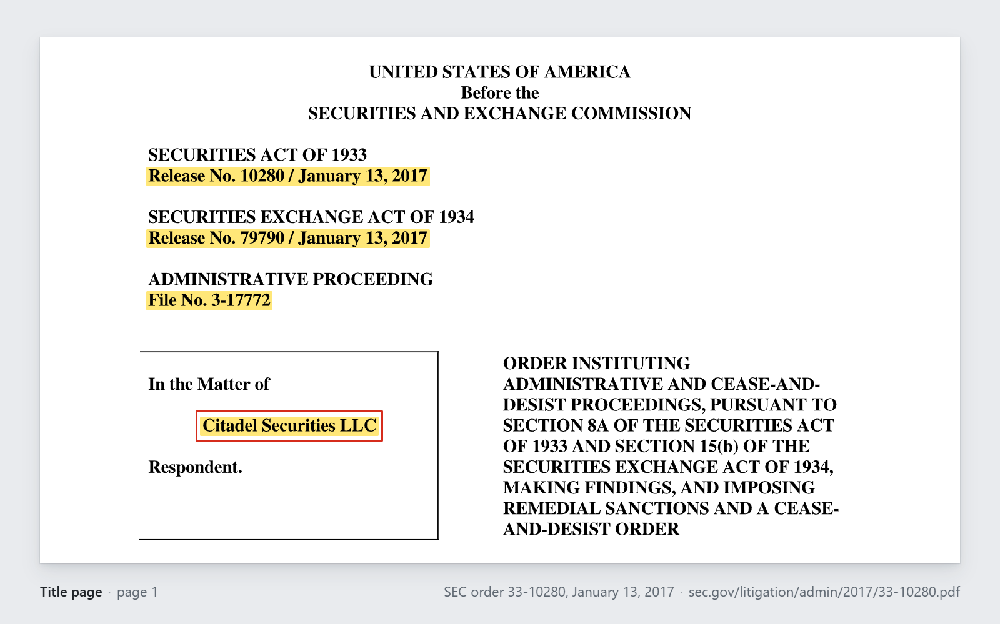
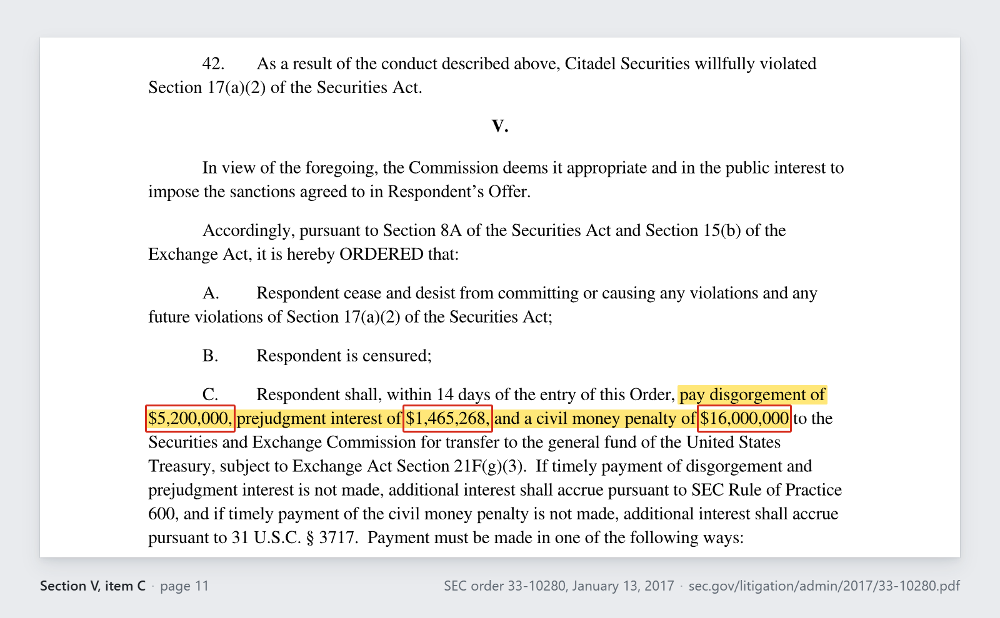
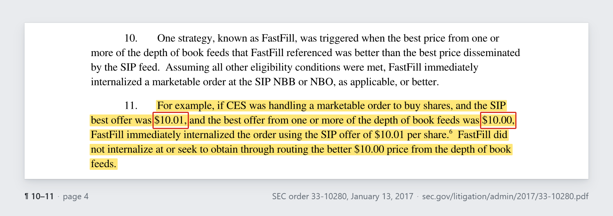
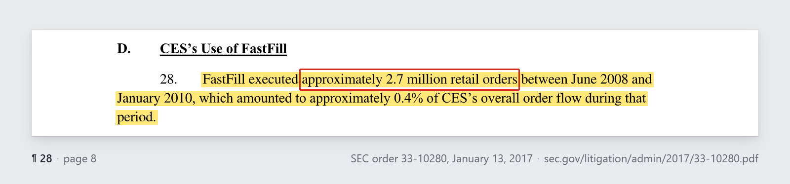
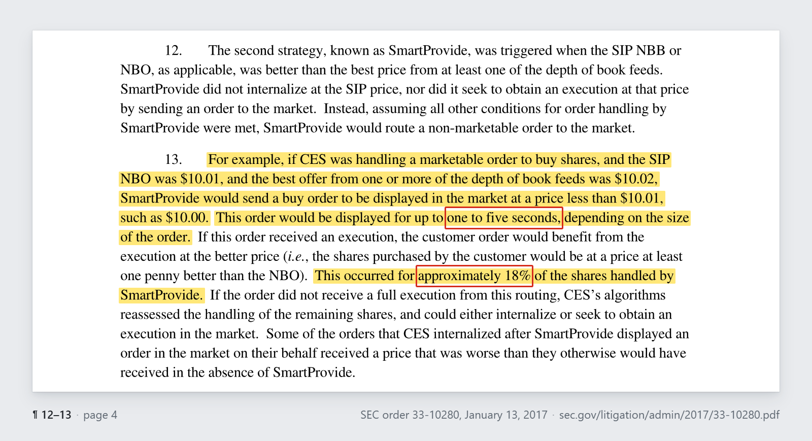
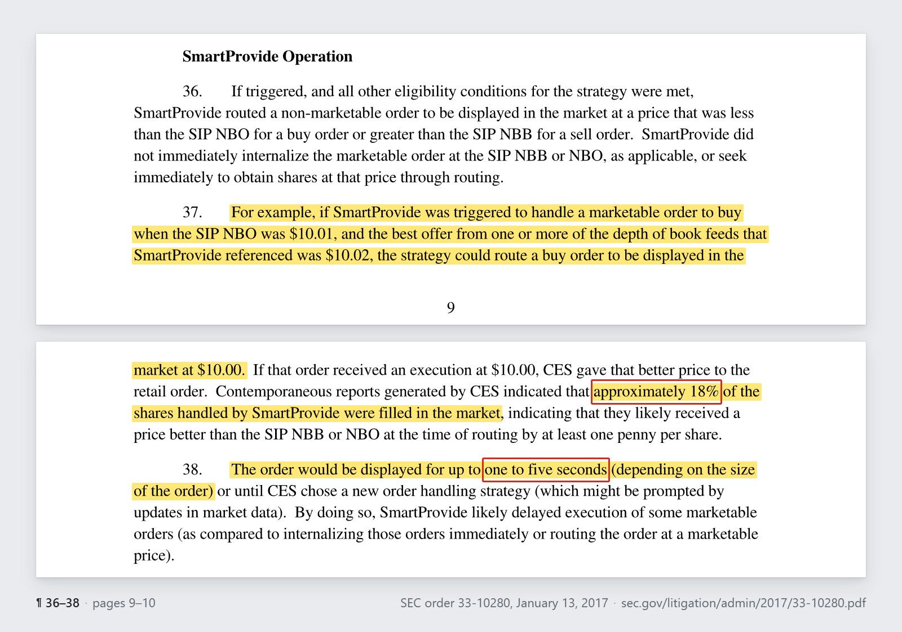

# Sources: the official documents behind this rebuild (checked 2026-11-18)

The code of FastFill and SmartProvide is not public: the SEC order and the patents below describe behaviour and
contain no code. These are the official documents, with their exact wording and numbers. The figures show the cited
pages of the SEC order PDF with the passages marked; they are rebuilt from the PDF by `docs/img/src/`.

## 1. The SEC order on FastFill and SmartProvide
- In the Matter of Citadel Securities LLC. Securities Act Release No. 10280 / Exchange Act Release No. 79790,
  Administrative Proceeding File No. 3-17772, January 13, 2017.
  PDF: https://www.sec.gov/litigation/admin/2017/33-10280.pdf (copy: docs/sec_order_2017_33-10280.pdf, text:
  docs/sec_order_2017_33-10280.txt)
  Press release 2017-11: https://www.sec.gov/news/pressrelease/2017-11.html

- Ordered to pay (Section V, item C, page 11): disgorgement $5,200,000 + prejudgment interest $1,465,268 + civil money
  penalty $16,000,000 = $22,665,268. Censured. Cease and desist from violating Securities Act 17(a)(2). Neither
  admitted nor denied.

- The unit: Citadel Execution Services (CES), a wholesale market maker (para 3), is the Citadel Securities business
  unit that handles orders from retail broker-dealers and other sources by internalizing or routing them (para 17). At
  the time of the order (January 2017), CES's orders accounted on average for about 35% of the average daily volume of
  retail equity shares traded in the US (para 17).
- Two views of the market: the public SIP feed (consolidated, round lots only, slower; average SIP consolidation latency
  at the start of 2010: 4.04 ms NYSE, 5.42 ms Nasdaq, fn 9) and direct depth-of-book feeds (odd lots included, received
  sooner) (para 4-7, 19-25).
- FastFill (para 10-11, 28-32): triggered when one or more direct feeds showed a better price than the SIP; if its other
  eligibility conditions were met, it immediately internalized the order at the SIP price or better. Example: buy
  order, SIP offer $10.01, direct feeds $10.00 -> internalized using the SIP offer of $10.01 (fn 6: generally with some
  price improvement). Price improvement "often was not sufficient to equal the price difference that had triggered the
  strategy" (30). About 2.7 million retail orders, June 2008 - January 2010, about 0.4% of CES order flow (28).

- SmartProvide (para 12-13, 33-34): triggered when the SIP showed a better price than at least one direct feed; instead
  of filling at the SIP price it displayed a non-marketable order for up to 1 to 5 seconds (example: SIP offer $10.01,
  direct $10.02 -> bid displayed at $10.00). About 18% of shares got the better price; some of the rest got a worse
  price than without SmartProvide. About 690,000 marketable orders, about 490,000 internalized afterwards (33).

- Both: 2.6% of retail orders through CES's algorithmic engine, 0.6% of all CES flow (18). "CES has since discontinued
  these two algorithms" (para 3). What CES told clients: a market order is an "[o]rder to buy (sell) at the best offer
  (bid) currently available in the marketplace" (14).
- Quotes (press release): Stephanie Avakian, Acting Director of Enforcement: "Internalizers can't suggest they are doing
  one thing yet do another when it comes to pricing trades." Robert Cohen, Co-Chief of the SEC Enforcement Division's
  Market Abuse Unit: "These two algorithms represented a small part of Citadel Securities' internalization business, but
  they nevertheless affected millions of orders placed by retail investors because of Citadel Securities' large role in
  that market."

## 2. The patents (original assignee Citadel Investment Group; inventors Kenneth C. Griffin and Matthew Andresen)
- US 7,587,347 B2, Sep 8, 2009: "Computer implemented and/or assisted methods and systems for detecting, tracking and
  responding to toxic, or likely toxic, orders in an equities order flow using toxicity and/or profit analyzers".
  Inventors Kenneth C. Griffin and Matthew Andresen, Chicago. The assignee named on the patent is Citadel Investment
  Group, L.L.C. (now Citadel Enterprise Americas LLC / Citadel Enterprise IP Holdings LP, per Google Patents), not the
  respondent of the SEC order, Citadel Securities LLC; the SEC order never mentions the patent.
  Filed Nov 30, 2004 (provisional Oct 19, 2004). Scan: docs/patents/US7587347.pdf (front page: docs/img/patent_front.png).
  Abstract: lets equities broker-dealers execute orders "while simultaneously eliminating (or at least reducing) exposure
  to the negative consequences associated with toxic (or likely toxic) orders" by using "toxicity and/or profit analyzers".
- Divisional US 7,987,128 B2 (Jul 26, 2011; application 12/546,854): the same specification (RULES.md, Sources).
- Status: a certificate of correction (Mar 30, 2010) raised the term adjustment of US 7,587,347 from 745 to 1,170 days;
  Google Patents lists it as active, adjusted expiry 2028-02-13. US 7,987,128 is a divisional, not a continuation.
